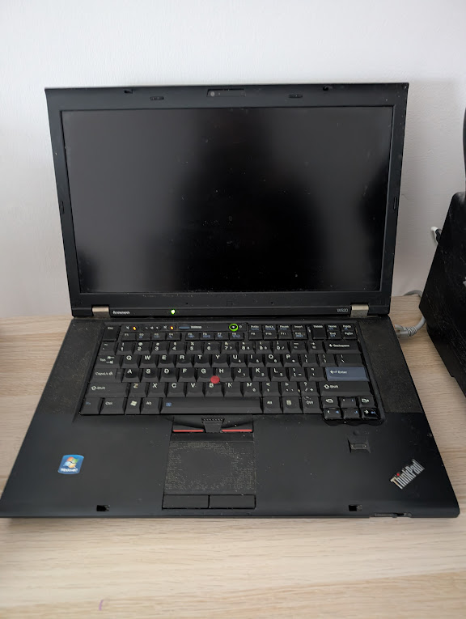

--- 
tags: [homelab, recurse]
---

# Building a homelab

Over the past half a year (starting around this post:
) I've been slowly building out
a homelab.

Despite being adjacent to communities where this is common ([Recurse], etc.),
this wasn't something I thought I would do a few years ago: too much effort
for the expected return.  A couple of things changed since then:

* My [present work at Voltus] requires me to at least think of infrastructure
issues a fair bit more: the engineering team is still small enough that
I need to get into the weeds of how things are configured, deployed and
monitored-- not just how they work at the data and application layer.
* The software stack around it has gotten better: we're long past the days where
this meant dangerously exposing a raw Linux system on a router. Also there
are many more actually useful things you can *run*.
* LLMs make this type of thing vastly easier to build independently with only 
generalist-level knowledge.

The exact architecture is still a work in progress, but the basic components
are in place:

* Using [Tailscale] for the network boundary. This lets me run a
bunch of network services using my local machines without
exposing them directly to the internet. I can run services with minimal (or even no) 
built-in authentication since access is controlled by the tailnet.
* Using an old w520 for the main "persistent" system server running the network services. 
8 GB, Intel Sandy Bridge. It's underpowered by today's standards but more than enough to run the
types of things I might want to do (music servers, read-it-later, lightweight
notebooks, ai agent harnesses).
* Storing persistent configuration as a git repository. Mostly a bunch of 
docker service definitions and systemd units, along with README.md files describing 
how to set it up and run it when I inevitably forget. I'm thinking about moving some
of this to [nix] someday, but haven't found a compelling reason to do so other than
"nix is cool, I want to learn more about it" (maybe that's enough).

Here is the server in all its glory:

The setup so far is:

* [jellyfin] for music listening
* [readeck] for saving useful posts to disk (after Mozilla discontinued Pocket, I determined 
that I should never trust a third party service to do this again)
* [marimohub] for exploring analytical ideas / questions in notebook form (it's
a little under-documented right now, but it supports tailscale authentication
headers out of the box, I might write more about this later) 
* [pi-web] for interactive coding (honestly mostly used for working on this system recursively, but maybe more one day)

I'm pretty happy with the setup as a learning experience. I've been using
various LLMs to build it, but try to understand their end products. Feels like
the appropriate use of technology: the configuration is mostly boilerplate, 
the interesting questions for me are higher level: what does each additional piece of functionality allow me to do, what are the
risks, etc. I could of course "do things the hard way" and reproduce tailscale
configuration and systemd files from scratch but it just doesn't seem quite
worth it. At present, I don't have the ambition of becoming an infrastructure engineer.

I don't really have illusions that this system is incredibly useful or life
changing in itself-- it just replaces a few cloud services I would
otherwise pay for (or be sad when they go away, as happened with Pocket). Most
of the value is in the experience of building it.

[present work at Voltus]: https://marimo.io/blog/case-study-voltus 
[Recurse]: https://www.recurse.com/
[jellyfin]: https://jellyfin.org/
[readeck]: https://readeck.org/en/
[marimohub]: https://github.com/marimo-team/marimohub
[pi-web]: https://pi-web.dev/
[tailscale]: https://tailscale.com/
[nix]: https://nixos.org/

